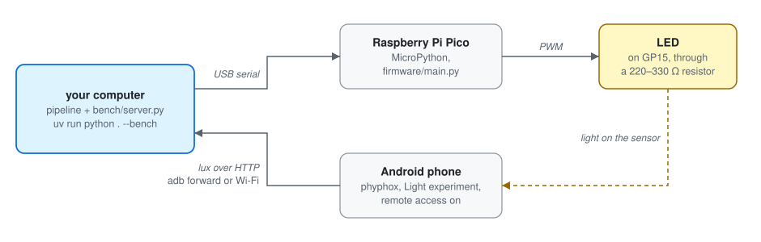
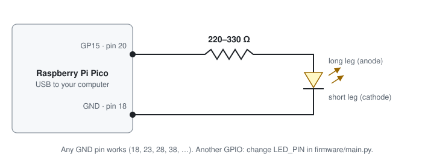
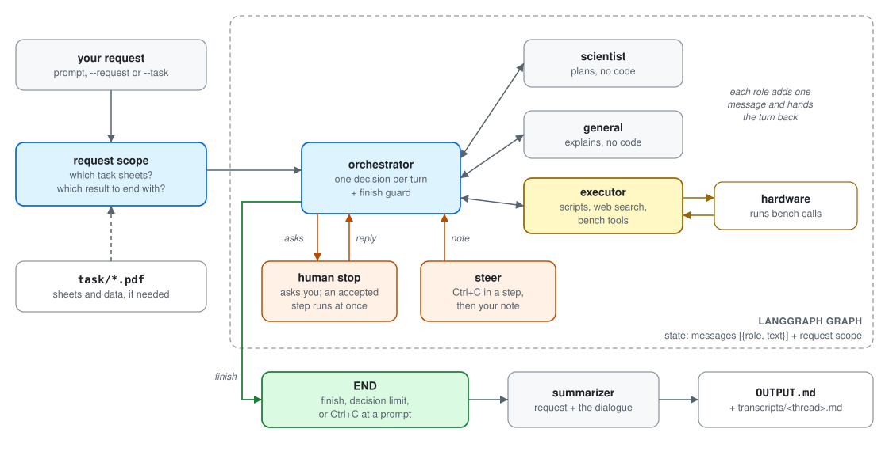
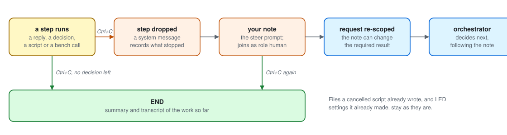
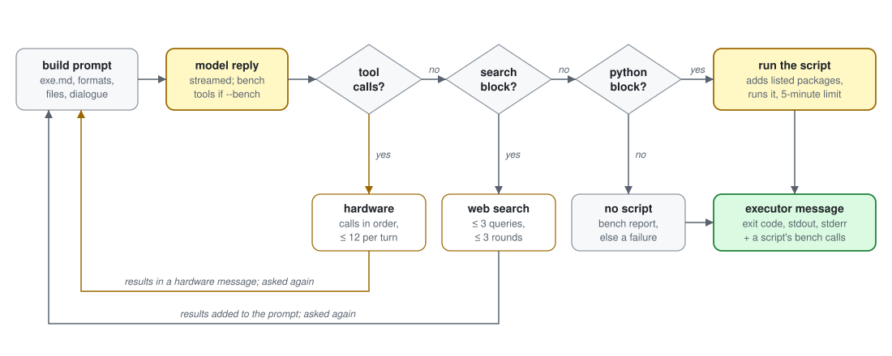
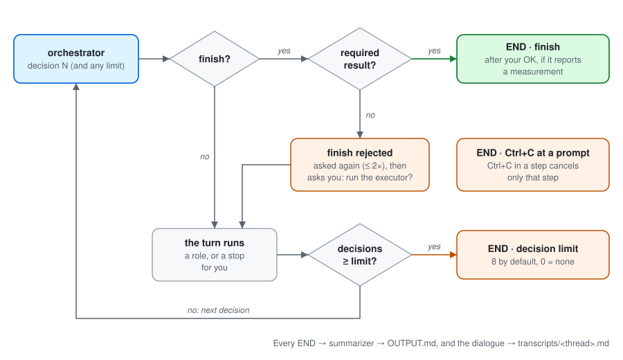
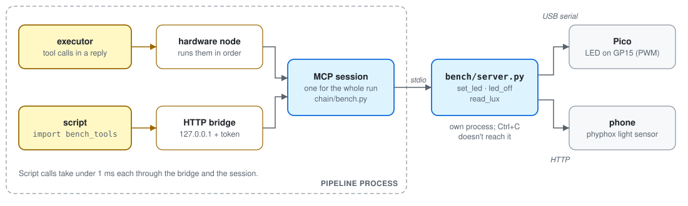

# Photonics AI Solver Chain

You type a request, and a team of four AI roles works on it together in one shared dialogue:

| Role             | What it does                                                                          |
| ---------------- | ------------------------------------------------------------------------------------- |
| **orchestrator** | Reads the dialogue and decides who acts next                                          |
| **scientist**    | Writes plans: equations, methods, numbered steps. No code                             |
| **general**      | Explains concepts, data and errors. No code                                           |
| **executor**     | The only role with tools: runs scripts, searches the web, and drives the light bench |

It is built on [LangGraph](https://github.com/langchain-ai/langgraph), every model runs through [OpenRouter](https://openrouter.ai/), and every run ends with a report in `OUTPUT.md`.

The project covers three PhotonicsAI homework sheets, kept in `task/`:

| Homework              | Sheet                              | What it adds |
| --------------------- | ---------------------------------- | ------------ |
| Homework 1, Tasks 5–6 | [`task/task1.pdf`](task/task1.pdf) | The four-role team. Main task: fit a neural-network ODE model to the Silverbox data and report a free-run test RMSE |
| Homework 2, Task 1    | [`task/task2.pdf`](task/task2.pdf) | A [human stop](#human-stop): the team asks you before risky steps |
| Homework 2, Task 2    | [`task/task2.pdf`](task/task2.pdf) | The simulated DMD focusing bench. It lives in a separate codebase |
| Homework 3            | [`task/task3.pdf`](task/task3.pdf) | [Hardware in the loop](#light-bench): an LED and a light sensor, reached through an MCP server |

The team reads a sheet only when your request refers to it, so you can ask it anything.

## Setup

You need Python 3.13 and an `OPENROUTER_API_KEY`: every model call goes through OpenRouter, web search included. Every package the project needs is listed in [`pyproject.toml`](pyproject.toml), so install from it with pip or with uv.

**With pip**, in a virtual environment:

```sh
python3.13 -m venv .venv
source .venv/bin/activate
pip install --upgrade pip        # --group below needs pip 25.1 or later
pip install -e . --group dev     # the project and its packages; --group dev adds pytest
```

**With [uv](https://docs.astral.sh/uv/)** (`brew install uv`, or `curl -LsSf https://astral.sh/uv/install.sh | sh`), which also installs Python 3.13 if you don't have it and uses the exact versions pinned in `uv.lock`:

```sh
uv sync                          # or let the first `uv run` do it
```

The executor follows the way you started the pipeline. Its scripts run on the same Python. When a script needs a package that isn't installed, it is added with `uv add` under `uv run`, which records it in `pyproject.toml` and `uv.lock`. Otherwise it is installed with `pip install` into your environment.

Two optional inputs live in `task/`:

- **`task/*.pdf`**: the homework sheets. A request can refer to them, or `--task` can make one the request.
- **`task/SNLS80mV.mat`**: the Silverbox data, from `SilverboxFiles.zip` on [nonlinearbenchmark.org](https://www.nonlinearbenchmark.org/). Without it, the executor finds the data on the web.

**The light bench** needs a Raspberry Pi Pico with an LED, and an Android phone running phyphox. Follow **[docs/bench-setup.md](docs/bench-setup.md)**; each step there ends with a check.

<p align="center"></p>

The LED is wired from pin 20 (GP15) through a 220–330 Ω resistor, and back to a GND pin:

<p align="center"></p>

- **Automatic with `--bench`:** the MCP server starts and stops with the run. It finds the Pico, opens its serial port and starts the phyphox measurement. Don't run `mcp dev` or `mcp run` at the same time, or they hold the serial port.
- **Yours, before each session:** keep phyphox open with the screen on, and run `adb forward tcp:8080 tcp:8080` (again whenever the phone reconnects). Or use Wi-Fi with `--phyphox-url`.

## Quick start

Once it's installed, from the project root:

```sh
export OPENROUTER_API_KEY=...       # needed for every run
python .                            # asks for your request (with uv: uv run python .)
python . --bench                    # the same, with the light bench connected (set it up first)
```

The commands in this README are written for an activated environment. With uv, put `uv run` in front of them instead.

A prompt lists the task files (and, with `--bench`, the bench tools). Type your request and press Enter.

| You press | What happens |
| --- | --- |
| Enter on an empty line | Nothing: empty lines are ignored |
| Ctrl+C at the request prompt | Quits without running anything |
| Ctrl+C while a step runs | Cancels that step only, and you type a note that steers the team ([Cancel and steer](#cancel-and-steer)) |
| Ctrl+C at any prompt during a run | Stops the run. You still get the transcript and the report |

Other ways to start:

```sh
python . --task task1                                # Homework 1's sheet is the request
python . --request "What does a lux meter measure?"  # the request as a flag, for scripted runs
python . --max-decisions 8                           # stop after 8 decisions, as Homework 1, Task 6 asks (default: no limit)
```

## How it works



Every turn goes through the orchestrator. Each role reads the whole dialogue, adds one message and hands the turn back.

1. **Start.** The CLI creates a working directory: a new `$TMPDIR/photonics_*` folder (kept after the run), or `--workdir`. With `--bench`, it starts the bench server.
2. **Request.** From the prompt, from `--request`, or from the sheets named with `--task`.
3. **Scope.** One model call decides which sheets the request needs and which result it must end with ([Request scope](#request-scope)).
4. **Turns.** The orchestrator picks the next role and writes its instruction. It sees the dialogue (its last ~45k characters), the required result, its decision number (and the limit, if one is set), and the files in the working directory. The role then reads its prompt from `prompts/` plus the whole dialogue, and replies.
5. **End.** On an accepted `finish`, at the decision limit (if `--max-decisions` sets one), or on Ctrl+C at a prompt. The dialogue is saved to `transcripts/<thread>.md`, and a summarizer writes `OUTPUT.md` with four sections: Request, Approach, Results and Conclusion.

Under the hood:

- The graph state is a list of `{role, text}` messages plus the request scope. Each node returns only its new messages, and LangGraph appends them.
- Every model call is retried with exponential backoff until it succeeds. A failing structured model is recreated before the retry.

### Request scope

Before the first decision, one structured call (`RequestScope`) reads your request. Its answer is shown in a "Request scope" table.

**Which sheets (`tasks`).** The call sees the start of every sheet in `task/`, and picks the ones the request works on or refers to through something only that sheet defines (a homework or task number, its data, its model).

- Each picked sheet goes into the dialogue as a `task` message, before your request. The team never sees the others.
- Data that comes with a sheet is copied into the working directory, and every prompt gets a note on how to load it. `TASK_DATA` in `chain/config.py` maps `task1.pdf` to `SNLS80mV.mat`.

**Which result (`result` and `quantity`).** What the final answer must rest on:

| `result` | Meaning | Example request |
| --- | --- | --- |
| `script` | A value a script prints, labelled `quantity` (such as `RMSE`) | "Solve Homework 1, Task 5 with a smaller network." |
| `bench` | A light reading from the bench | "Make it 200 lux." |
| `none` | An explanation, a plan, or an answer from knowledge | "What does a lux meter measure?" |

The result sets the [finish check](#how-a-run-ends), the "Required Result" note in the orchestrator's prompt, the label the executor prints, and the fallback step.

- `--task NAME` (for example `--task task1`; repeatable) sets the sheets instead of the call. `--task none` gives none.
- With no request, the sheets named with `--task` are the request: `python . --task task3 --bench`.
- The scope is checked again after you answer an ambiguous question or send a steering note. If you choose "explain the error" over "measure it", the run no longer needs a printed number to finish.

### Human stop

Besides `scientist`, `general`, `executor` and `finish`, the orchestrator can choose `human`. The same structured decision then also carries `stop_kind`, `pending_step`, `question` and a one-sentence `reason`. There are no keyword lists or fixed rules; `prompts/orc.md` describes the two kinds of stop:

| Stop | When | After your reply |
| --- | --- | --- |
| **Ambiguous query** (`stop_kind: ambiguous_query`) | The request has several readings that would send the work to different roles or change the number reported. The question lists them as options | Your reply joins the dialogue as role `human`, the request is re-scoped, and the next decision follows your reading |
| **Hard decision** (`stop_kind: hard_decision`) | The next step would run the executor (any script or bench step) or overwrite a result on disk (`pending_step: executor`), or end the run and report a measurement (`pending_step: finish`) | **Accept:** the step runs at once, with no new decision. **Refuse:** a `system` message records that it didn't run, and the turn goes back to the orchestrator |

- **Pause.** The graph is compiled with a checkpointer (`InMemorySaver`), and each run is one thread (`--thread`, or a generated id). The `human` node calls LangGraph's `interrupt()`, so the graph pauses with its state saved, and the question appears in a red panel.
- **Resume.** Your reply resumes the same thread with `Command(resume=reply)`. An empty reply asks again.
- **Accept or refuse.** On a hard decision, a small structured call (`HumanVerdict`) decides whether your free-text reply accepts. "No, keep the old file" and "use 3 epochs instead" are refusals.
- **Count.** Each stop counts as one orchestrator decision.

The two runs for Homework 2, Task 1 use `--workdir`, which keeps a working directory between runs, so a later request can see (and could overwrite) an earlier one's results:

```sh
# (a) ambiguous: free-run vs one-step-ahead error, or a new measurement vs an existing one
python . --max-decisions 8 --workdir runs/silverbox --request "What is the Silverbox model's error?"

# (b) hard decision: retraining runs a script and would overwrite results. Refuse once, then accept
python . --max-decisions 8 --workdir runs/silverbox --request "Retrain the Silverbox model and report the new test RMSE."
```

### Cancel and steer

Ctrl+C while a step runs cancels that step, not the run: a reply as it streams, the orchestrator's decision, a script, a web search or a bench call.



1. **Cancel.** The step stops and its reply is discarded. A running script is killed along with everything it started; files it already wrote and LED settings it already made stay. Bench calls a cancelled script made still go into the dialogue as a `hardware` message.
2. **Note.** A `system` message records what was cancelled, and a yellow panel asks what the team should do instead.
3. **Steer.** Your note joins the dialogue as role `human`, the request is re-scoped, and the orchestrator decides next. `prompts/orc.md` tells it to follow the note.

Ctrl+C ends the run instead when you press it at a prompt (the steer prompt too, so Ctrl+C twice stops), or, with `--max-decisions`, when the limit is reached and no decision is left to follow a note. A note isn't a decision; the orchestrator's next decision counts as usual.

How it works:

- When a node is interrupted, LangGraph keeps the checkpoint from before that step. `run_thread` writes the note with `update_state(..., as_node="cancel")`, which drops the cancelled step so it never runs again. The `cancel` node never runs itself; its edge leads to the `steer` node, which pauses with `interrupt()` like the human stop.
- Scripts run in their own process group, and a cancel or a timeout kills the whole group, including any processes the script started.
- The bench server runs in its own session, so Ctrl+C doesn't reach it and the serial port stays open.

### One executor turn



| The reply contains | What happens |
| --- | --- |
| Tool calls (with `--bench`) | A [hardware turn](#light-bench), then the executor is asked again |
| A ` ```search ` block (up to 3 queries) | A web search. The results go into the prompt and the executor is asked again. After 3 rounds it's told to write the script |
| A ` ```dependencies ` block | Those packages are installed: `uv add` under `uv run`, otherwise `pip install`. If that fails, the script doesn't run |
| A ` ```python ` block | Saved as a new numbered file in the working directory and run there on the pipeline's Python, with a 5-minute limit. It can use `bench_tools` |
| None of these | Nothing runs. After bench calls in the same turn this is the executor's report; otherwise it's a failure |

### How a run ends

<p align="center"></p>

A `finish` is accepted only when the most recent executor turn holds the required result:

| Scope `result` | The most recent executor turn must… |
| --- | --- |
| `script` | show `Exit code: 0`, with the `quantity` and a number in its output |
| `bench` | have a successful `read_lux` as its last bench call |
| `none` | nothing: the run can always finish |

If it doesn't, the orchestrator is asked again with a rejection note, up to 2 times. If it still chooses `finish`, the decision becomes a hard-decision stop asking whether to run the executor.

With `--max-decisions`, the limit is checked after each turn, so the last decision's role still runs.

## Light bench

With `--bench`, the executor drives a light bench: an LED on a Raspberry Pi Pico, measured in lux by phyphox on an Android phone. [`bench/server.py`](bench/server.py) is an MCP server with three tools: `set_led(percent)`, `led_off()` and `read_lux()`. The executor reaches them in two ways:



**Tool calls** suit a few steps of adjusting and measuring. When a reply calls tools, the `hardware` node:
1. runs the calls one by one, in order;
2. writes each call and its result to the dialogue as a `hardware` message;
3. hands the turn back to the executor, which reads the result and decides again.

A reply without tool calls is the executor's report and ends its turn. One executor turn can make up to 12 hardware turns (`HARDWARE_ROUNDS`).

**Scripts** suit sweeps, many measurements, or timed patterns such as pulsing the LED. A script does `import bench_tools`:

```python
import bench_tools
bench_tools.led_off()
bench_tools.set_led(40)        # "LED set to 40% (Pico: OK 40)"
lux = bench_tools.read_lux()   # 19.0
```

- [`bench/bench_tools.py`](bench/bench_tools.py) uses only the standard library. With `--bench`, it is copied into the working directory.
- Its calls go into the same MCP session through a bridge: an HTTP endpoint on `127.0.0.1` with a random token, passed to the script in `BENCH_URL` and `BENCH_TOKEN`.
- Every call a script makes is added to the dialogue as a `hardware` message after the script's result. The next turn reads it, and the finish check counts a final `read_lux`.

### Timing

Nothing in the bench waits. `set_led` and `led_off` return as soon as the Pico replies, in a few milliseconds (the bridge and the MCP session add under 1 ms), and `read_lux` returns the phone's latest value at once. So a script sets its own pace: it can pulse or fade the LED as fast as it updates it.

### Keeping the team on the tools

- Only the executor gets the tools, bound to its model with `bind_tools`. The others learn about the bench from notes in their prompts:
  - **executor:** the bench tools come before the script format, and no other Python module reaches the bench;
  - **orchestrator:** send bench steps straight to the executor, with the tools named;
  - **scientist and general:** the bench is reached only through `set_led`, `led_off` and `read_lux`.
- For a bench request, the executor's first reply in a turn must call a tool (`tool_choice="required"`), so it can't open with a script that guesses at a library. The model still picks the tool and its values. Later replies can be more tool calls, a `bench_tools` script, or the report.
- If a request needs the bench but the run started without `--bench`, the CLI offers to connect it. Saying no runs nothing.

Also:

- **One session.** The pipeline starts the server over stdio and keeps one session open for the whole run, so the Pico's serial port stays open between calls. The graph is synchronous, so the session runs on its own event loop in a background thread.
- **Same human stop.** A bench step is an executor step, so it needs your approval first.
- **Fails fast.** If the server can't start (no Pico, phyphox unreachable), the run stops before any model is called.

A bench request, start to finish (the run's transcript records the real calls and readings in this order):

1. The CLI starts the MCP server, which opens the Pico's serial port and starts phyphox. Then the request prompt opens.
2. The request is scoped (`result: bench`), and the orchestrator asks you before the executor runs.
3. The executor's tool calls go through the hardware node and the MCP server to the Pico and the phone, and the results come back into the dialogue. This repeats until its report.
4. Finishing with the measured lux is a second question to you. Then the CLI closes the session and writes the transcript and `OUTPUT.md`.

Requests to try (start `python . --bench`, then type one; each is a separate run):

- Make it 200 lux.
- Turn the LED off and tell me the light level in the room.
- Measure the light level at 0, 25, 50, 75 and 100 percent.
- Find the lowest LED setting that gives at least 100 lux.

## Reference

### Flags

Run `python . --help` to see them in the terminal.

| Flag | Default | Effect |
| --- | --- | --- |
| `--request TEXT` | asks at the prompt | The request, for scripted runs |
| `--task NAME` | decided from the request | A sheet from `task/` (`task1` or `task1.pdf`; repeatable), or `none`. With a request it is background; without one, it is the request |
| `--max-decisions N` | `0` (no limit) | Maximum orchestrator decisions, counting stops for you. `0` means no limit. Homework 1, Task 6 uses `8` |
| `--workdir PATH` | a new temp folder | Working directory to use and keep across runs |
| `--thread ID` | generated | LangGraph thread id; also the transcript's file name |
| `--bench` | off | Start `bench/server.py` and give its tools to the executor |
| `--pico-port PORT` | `$PICO_PORT`, else auto-detect | The Pico's serial port, for example `/dev/cu.usbmodem31201` or `/dev/ttyACM0` |
| `--phyphox-url URL` | `$PHYPHOX_URL`, else `http://localhost:8080` | phyphox's address on the phone |

The device settings are never hard-coded. The bench's own scripts take the same settings:

| Setting | Pipeline flag | Bench script flag | Environment variable | Default |
| --- | --- | --- | --- | --- |
| Pico serial port | `--pico-port` | `--port` | `PICO_PORT` | The connected Pico, found by its USB vendor ID |
| phyphox address | `--phyphox-url` | `--url` (phone script), `--phyphox-url` (server) | `PHYPHOX_URL` | `http://localhost:8080`, the adb forward |

### Settings

| Setting | Where | Default |
| --- | --- | --- |
| `MODEL`, the OpenRouter model for every call | `chain/config.py` | `google/gemma-4-31b-it` |
| `MAX_DECISIONS`, the default for `--max-decisions` | `chain/config.py` | 0 (no limit) |
| `WEB_SEARCH_ROUNDS`, search rounds per executor turn (up to 3 queries each) | `chain/config.py` | 3 |
| `HARDWARE_ROUNDS`, hardware turns per executor turn | `chain/config.py` | 12 |
| `FINISH_REJECTIONS`, re-asks after an unjustified `finish` | `chain/config.py` | 2 |
| `ORCHESTRATOR_MAX_CONTEXT`, `max_tokens` for structured calls | `chain/config.py` | 200,000 |
| Script and package-install time limits | `code_tool`, `dependency_tool` in `chain/tools.py` | 300 s, 600 s |
| Results per web search | `web_search_tool` in `chain/tools.py` | 5 |
| Dialogue the orchestrator sees (oldest messages dropped first) | `_trim_dialogue` in `chain/orchestrator.py` | 45,000 chars |
| Executor reply formats | `EXECUTOR_CODE_FORMAT`, `EXECUTOR_BENCH_FORMAT` in `chain/executor.py` | |
| LED pin | `LED_PIN` in `firmware/main.py` | GP15 |

Each role's behaviour lives in its prompt, which you can edit: `prompts/orc.md`, `sci.md`, `gen.md` and `exe.md`.

### Models

Every call uses `MODEL` through OpenRouter.

| Call | Temperature | Kind | Notes |
| --- | --- | --- | --- |
| orchestrator | 0.2 | structured | `OrchestratorDecision` schema (JSON schema), `context-compression` plugin |
| request scope (at the start, after an answer to a question, after a steering note) | 0.2 | structured | `RequestScope` schema |
| reply judge (hard decisions) | 0.2 | structured | `HumanVerdict` schema |
| scientist, general | 0.01 | streamed | |
| executor | 0.01 | streamed | With `--bench`, the bench tools through `bind_tools`; the model must support tool calling |
| web search, for the executor | 0.01 | streamed | `web` plugin with 5 results, billed per request ([OpenRouter web search](https://openrouter.ai/docs/features/web-search)) |
| summarizer | 0.2 | streamed | |

### Tests

```sh
pytest            # or: uv run pytest
```

The tests need no API key and no hardware: scripted models stand in for OpenRouter, and [`tests/fake_bench_server.py`](tests/fake_bench_server.py) stands in for the bench. They cover:

- the MCP client, the hardware loop, and the forced first tool call;
- `bench_tools` scripts and the bridge, including a wrong token;
- that no bench server call waits;
- the finish check for each kind of scope;
- request scoping, its overrides, and re-scoping after an answer;
- cancelling a step with Ctrl+C and steering with a note, a cancelled script's bench calls, and Ctrl+C at the decision limit;
- the request prompt, and the offer to connect the bench.

### Safety

- The executor runs code written by a model, as your user and with network access. Scripts are written to the working directory, but nothing is sandboxed.
- Packages the executor installs stay in your environment. Under `uv run` they are also added to `pyproject.toml` and `uv.lock`, so check the diff after a run.
- Web searches cost OpenRouter credit on top of the model tokens.
- With `--bench`, the executor drives real hardware. Every bench step needs your approval, but within an approved step it can make up to 12 hardware turns without asking again.
