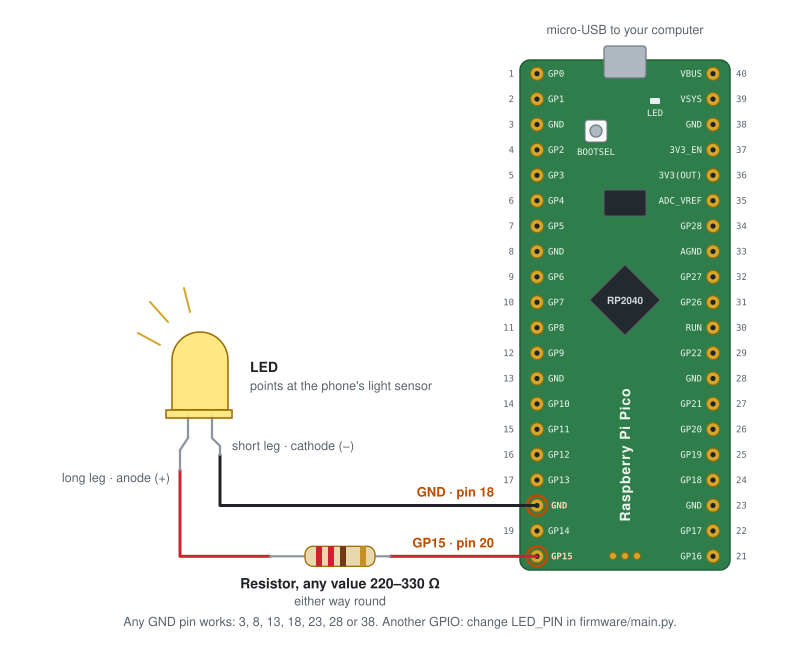

# Light bench setup

The light bench lets the executor set an LED's brightness and measure the light level. You only need it for `--bench` runs.


- A **Raspberry Pi Pico** running MicroPython dims the LED with PWM. Commands go over USB serial.
- An **Android phone** running phyphox measures the light in lux. Readings go over phyphox's HTTP remote access, through a USB port forward or over Wi-Fi.
- The pipeline talks to both through the MCP server in [`bench/server.py`](../bench/server.py).

Follow the steps in order. Each one ends with a check.

## What you need

### Hardware

| Item | Notes |
| --- | --- |
| Raspberry Pi Pico | A Pico W or Pico 2 also works; flash the MicroPython build for your board |
| USB cable for the Pico | It must carry data. Some cables only charge, and then the Pico never shows up |
| LED and a 220–330 Ω resistor | Plus a breadboard and jumper wires |
| Android phone with a light sensor | phyphox can only read the light sensor on Android, not on iPhone |
| USB cable for the phone | Not needed if you use Wi-Fi instead (step 6) |

### Software on your computer

The Python packages, [mpremote](https://docs.micropython.org/en/latest/reference/mpremote.html) included, come from `pyproject.toml` ([Setup](../README.md#setup)). Besides them you need:

| Tool | What it's for | macOS | Linux (Debian/Ubuntu) |
| --- | --- | --- | --- |
| adb (Android platform tools) | Forwards phyphox's port from the phone to `localhost` | `brew install --cask android-platform-tools` | `sudo apt install adb` |
| MicroPython firmware (`.uf2`) | The Pico's runtime | [RPI_PICO](https://micropython.org/download/RPI_PICO/), [RPI_PICO_W](https://micropython.org/download/RPI_PICO_W/) or [RPI_PICO2](https://micropython.org/download/RPI_PICO2/) | same |
| Node.js (optional) | Only needed for `mcp dev`, the MCP inspector | `brew install node` | `sudo apt install nodejs npm` |

The commands below are written for an activated environment, run from the project root. With uv, put `uv run` in front of them instead.

### Software on the phone

- [phyphox](https://play.google.com/store/apps/details?id=de.rwth_aachen.phyphox), from Google Play.

## 1. Wire the LED

The firmware drives the LED from **GP15**, which is physical pin 20.




Any GND pin works (18, 23, 28, 38, …). To use another GPIO, change `LED_PIN` in [`firmware/main.py`](../firmware/main.py).

## 2. Flash MicroPython onto the Pico

1. Hold the **BOOTSEL** button on the Pico, plug it into your computer, then let go. A drive named `RPI-RP2` appears (`RP2350` on a Pico 2).
2. Copy the `.uf2` file you downloaded onto that drive. The Pico reboots into MicroPython, and the drive disappears.

**Check:** `mpremote devs` lists the Pico, with `MicroPython` as the manufacturer.

## 3. Find the Pico's serial port

```sh
mpremote devs            # lists serial devices; the Pico shows "MicroPython"
ls /dev/cu.usbmodem*     # macOS, for example /dev/cu.usbmodem31201
ls /dev/ttyACM*          # Linux, for example /dev/ttyACM0
```

You usually don't need the port: the bench scripts find a connected Pico on their own, by its USB vendor ID. You need it in two cases:
- for `mpremote` in the next step;
- when more than one Pico is plugged in. Then pass it with `--port` (bench scripts) or `--pico-port` (the pipeline), or set `PICO_PORT` once:

```sh
export PICO_PORT=/dev/cu.usbmodem31201
```

On **Linux**, if opening the port gives "permission denied", add yourself to the `dialout` group, then log out and back in:

```sh
sudo usermod -aG dialout $USER
```

## 4. Copy the firmware to the Pico

```sh
mpremote connect /dev/cu.usbmodem31201 cp firmware/main.py :main.py + reset
```

This saves the firmware as `main.py` on the board, so it runs at every boot, and then restarts the board. Use your own port from step 3.

Name the port explicitly here. On its own, `mpremote` connects to the first serial device it finds, and an Android phone plugged in over USB can be one. Close anything else that has the port open first: a running pipeline, `mcp dev`, Thonny, or an `mpremote` REPL.

**Check:** the LED sweeps up and down. Press Ctrl+C to stop, which also turns the LED off.

```sh
python bench/pico_connector.py              # finds the Pico itself
python bench/pico_connector.py --port /dev/cu.usbmodem31201
```

## 5. Prepare the phone

1. **Developer options:** go to *Settings → About phone → Software information* and tap **Build number** 7 times. On phones other than Samsung, *Build number* is directly under *About phone*.
2. **USB debugging:** turn it on in *Settings → Developer options*.
   - On Samsung phones, turn off **Auto Blocker** first (*Settings → Security and privacy → Auto Blocker*). Otherwise it blocks USB debugging.
3. Plug the phone into the computer, and accept the "Allow USB debugging?" prompt on the phone.

**Check:** `adb devices` lists the phone as `device`. If it says `unauthorized`, accept the prompt on the phone. If nothing is listed, try another cable or USB port.

## 6. Start phyphox and connect to it

1. In phyphox, open the **Light** experiment (under *Raw Sensors*).
2. In the ⋮ menu, turn on **Allow remote access**. phyphox then shows an address such as `http://192.168.1.23:8080`.
3. Press ▶ to start measuring. Keep the app open with the screen on while you use the bench.
4. Connect your computer to phyphox in one of two ways:
   - **Over USB** (the default the scripts expect):

     ```sh
     adb forward tcp:8080 tcp:8080    # phyphox is now at http://localhost:8080
     ```

     Run this again whenever you reconnect the phone or restart adb, because the forward doesn't survive either.
   - **Over Wi-Fi:** with the phone and the computer on the same network, use the address phyphox shows. Pass it with `--url` (bench scripts) or `--phyphox-url` (the pipeline), or set it once:

     ```sh
     export PHYPHOX_URL=http://192.168.1.23:8080
     ```

**Check:** this prints one reading, such as `21.0 lux (from http://localhost:8080)`.

```sh
python bench/phone_connector.py
python bench/phone_connector.py --url http://192.168.1.23:8080
```

The scripts read phyphox's `illum` buffer. If your experiment names it differently, open `<phyphox address>/config` in a browser, find the buffer name, and set `BUFFER` in [`bench/phone_connector.py`](../bench/phone_connector.py).

## 7. Point the LED at the sensor

The light sensor sits next to the front camera, at the top of the screen. Point the LED at it from a few centimetres away. Shade the bench from room light, or readings will drift as the room changes.

**Check:** with the LED on (step 4's sweep, or `set_led` in step 8), the phone's reading rises as the brightness goes up. If it doesn't, move the LED closer to the sensor.

## 8. Try the MCP server (optional)

The pipeline starts the server itself, so this step is only for checking the tools by hand. It opens the MCP inspector in your browser and needs Node.js. Set `PICO_PORT` or `PHYPHOX_URL` if you need them, because `mcp dev` can't pass flags to the server.

```sh
mcp dev bench/server.py
```

To start the server by hand over stdio:

```sh
python bench/server.py --port /dev/cu.usbmodem31201 --phyphox-url http://localhost:8080
```

## 9. Run the pipeline with the bench

```sh
export OPENROUTER_API_KEY=...
python . --bench
python . --bench --pico-port /dev/ttyACM0 --phyphox-url http://192.168.1.23:8080
```

At startup a green "BENCH CONNECTED" panel lists the tools, and the request prompt opens. Type a request such as `Make it 200 lux.` and press Enter. The orchestrator asks before any bench step runs, and the executor then sets the LED and measures in a loop until the request is done.

## Troubleshooting

| Message or symptom | Cause and fix |
| --- | --- |
| `No Pico found on USB` | The Pico isn't connected as a serial device. Check that the cable carries data. If the `RPI-RP2` drive shows up instead, the Pico is in BOOTSEL mode or has no MicroPython yet: do step 2 |
| `Several Picos found` | Pass the one to use with `--port` / `--pico-port`, or set `PICO_PORT` |
| `could not open port …: Resource busy` | Another program has the port open: a running pipeline, `mcp dev`, `mcp run`, Thonny or an `mpremote` REPL. Close it |
| `No reply from Pico` | The firmware isn't running. Copy it again and reset the board (step 4) |
| `Connection refused` on `localhost:8080` | The USB forward is missing (run `adb forward tcp:8080 tcp:8080` again), remote access is off in phyphox, or the app was closed |
| `No light reading. Is the phyphox measurement running?` | Press ▶ in phyphox |
| `adb devices` shows `unauthorized` | Accept the USB debugging prompt on the phone |
| The lux reading doesn't change when the LED does | The LED isn't pointed at the sensor (step 7) |
| `permission denied` on `/dev/ttyACM0` (Linux) | Add yourself to the `dialout` group (step 3) |
